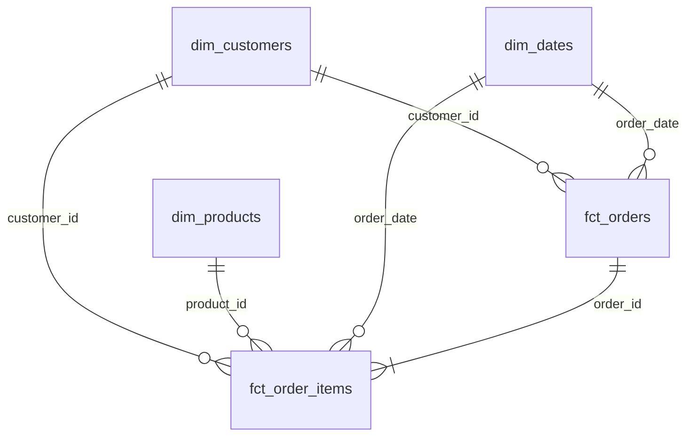
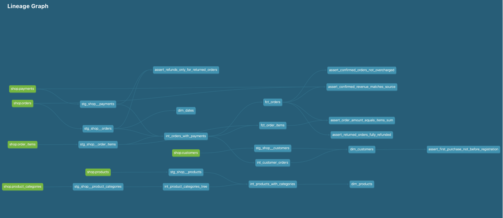

Домашнее задание 1: витрины интернет-магазина по схеме «звезда».

Сырые данные магазина лежат в PostgreSQL. Сервис loader копирует их в Greenplum.
Дальше с помощью dbt я построила из них три слоя:

- staging - очищенные копии сырых таблиц, по одной модели на каждую таблицу;
- intermediate - промежуточные расчёты: суммы оплат по заказу, дерево категорий, покупки клиентов;
- marts - готовые витрины для анализа.

## Модель данных

### ER-диаграмма

В центре два факта: заказы и товары в заказах, вокруг три справочника: клиенты, товары и календарь.

Подпись на линии - это ключ, по которому таблицы связаны.

### Витрины

| Витрина | Одна строка | Для чего нужна |
|---|---|---|
| fct_orders | один заказ, без тестовых | выручка, число заказов, средний чек по городам |
| fct_order_items | один товар в заказе | выручка по категориям, брендам и месяцам, какие бренды чаще возвращают |
| dim_customers | один клиент, в том числе те, кто ничего не купил | доля покупателей по каналам привлечения, первая покупка клиента |
| dim_products | один товар | бренд и категории товара: своя, родительская и верхняя |
| dim_dates | один день | группировка по месяцам, кварталам и выходным |

Подтверждённой покупкой я считаю заказ со статусом paid, у которого есть хотя бы одна успешная оплата. Возврат оплатой не считается.

### Граф зависимостей

Скриншот из dbt docs:

## Хранение в Greenplum

В Greenplum таблица делится между сегментами. Если две таблицы соединяются по ключу, лучше,
чтобы нужные строки лежали на одном сегменте, тогда их не придётся пересылать между сегментами.

| Витрина | Как хранится | Почему |
|---|---|---|
| fct_orders | distributed by (order_id) | у каждого заказа свой order_id, поэтому строки делятся по сегментам ровно |
| fct_order_items | distributed by (order_id)| тот же ключ, что у fct_orders: товары заказа лежат рядом с самим заказом, и соединять их быстро|
| dim_customers | distributed replicated | маленькая таблица, поэтому копия лежит на каждом сегменте |
| dim_products | distributed replicated | маленькая таблица  |
| dim_dates | distributed replicated | маленькая таблица |

## Что нашли тесты

Тест assert_confirmed_orders_not_overcharged проверяет, что с клиента не списали больше, чем стоит заказ.
Он нашёл заказ 113: заказ стоит 200, а успешных оплат две по 200, то есть клиент заплатил 400.
Это ошибка в самих данных, поэтому я их не исправляла, а поставила тесту уровень warn.
Сборка проходит, но предупреждение показывает проблему.

## Дополнительное задание

Я выбрала вариант с пакетом dbt_utils. Пакет подключён в packages.yml и скачивается командой dbt deps. Календарь dim_dates построен макросом dbt_utils.date_spine, он генерирует все дни
от первой до последней даты заказа.

